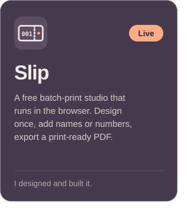
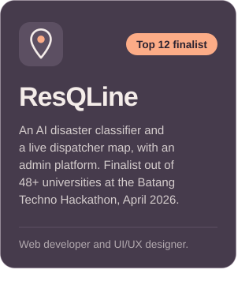
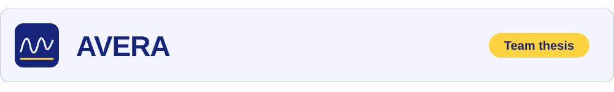

**A designer who builds what he designs.** Open to on-the-job training (OJT) in UI/UX design and front-end development.

### Selected work

A free batch-print studio that runs in the browser. Design a race bib, name badge, sticker or ticket once, add numbers or names, and download a print-ready PDF. 
**My part:** designed and built it. [Open Slip](https://slip-studio.vercel.app/)

An AI disaster classifier and a live dispatcher map, with an admin platform. Top 12 finalist out of 48+ universities at the Batang Techno Hackathon, April 2026. 
**My part:** web developer and UI/UX designer.

An Android app that verifies handwritten signatures with Siamese neural networks and explains its decisions. 
**My part:** admin and analyst flows in Figma, and the React Native interface.

[See all projects](https://joko-comia.vercel.app/projects)

### Skills

**Design** `Figma` `Canva` `Illustrator` `Photoshop` 
Advanced in Figma and Canva, basic in Illustrator and Photoshop.

**Front-end** `HTML` `CSS` `JavaScript` `React` `React Native` `Next.js` `Shopify Liquid`

**Code** `Git` `GitHub` `Java` `C#` `C++`

**Also** AI-assisted design and development

 

