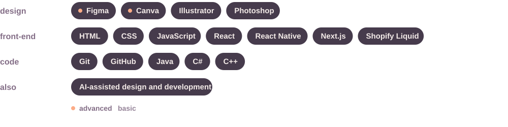

**A designer who builds what he designs.** Open to on-the-job training (OJT) in UI/UX design and front-end development.

## 01 — work

[all projects ↗](https://joko-comia.vercel.app/projects)

## 02 — skills

 

